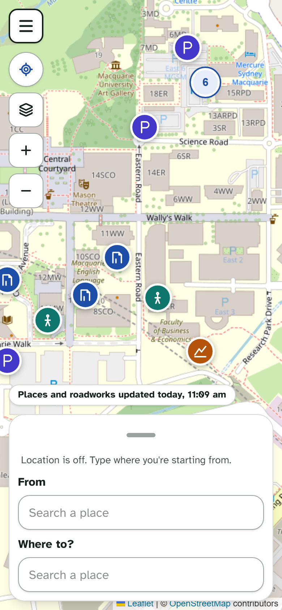
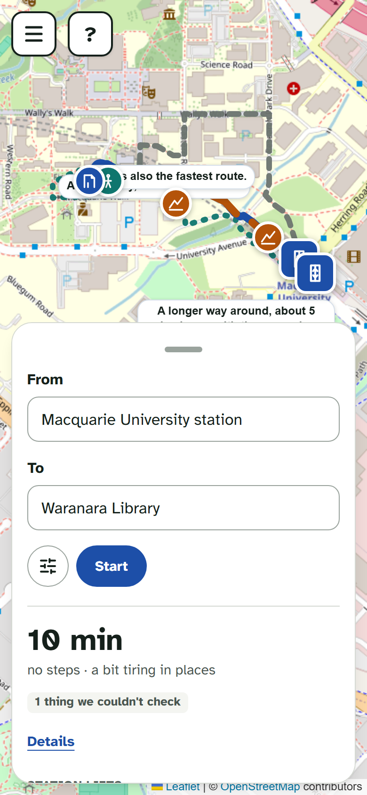
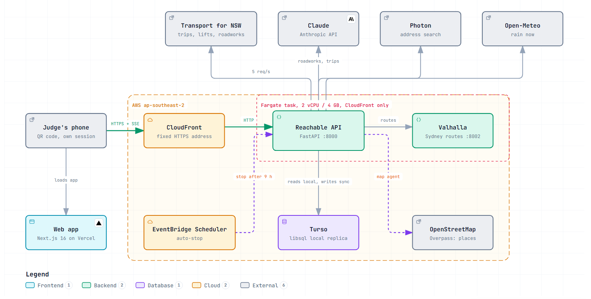
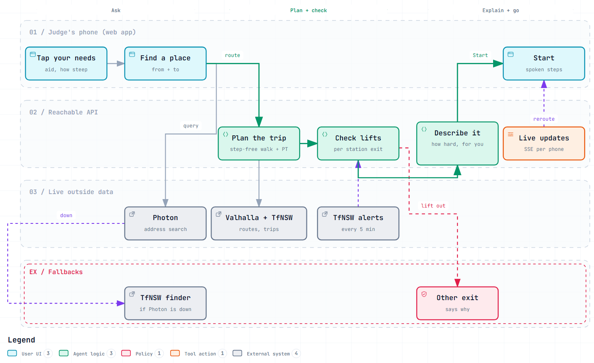
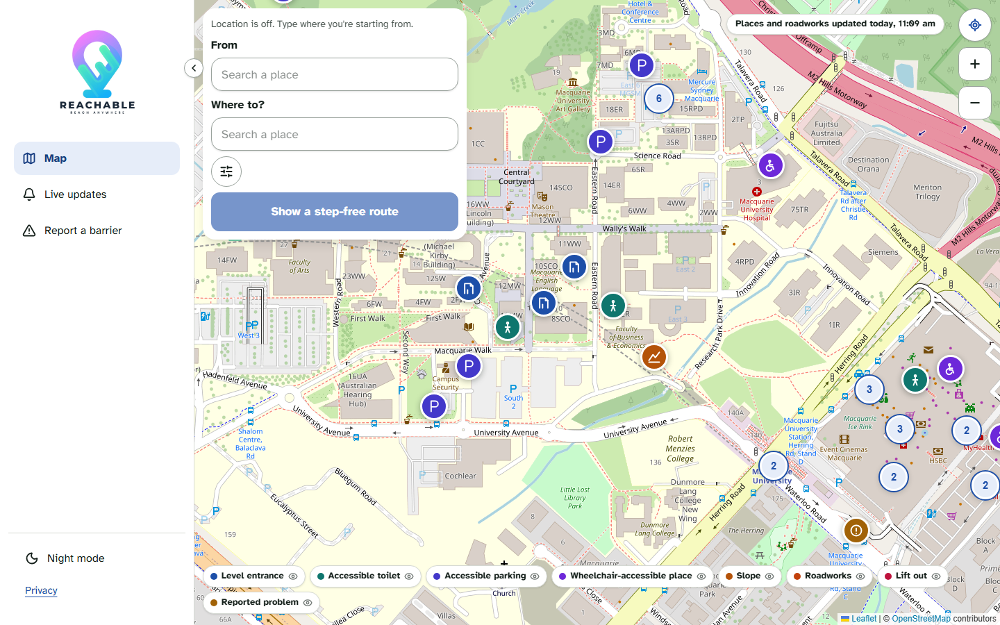
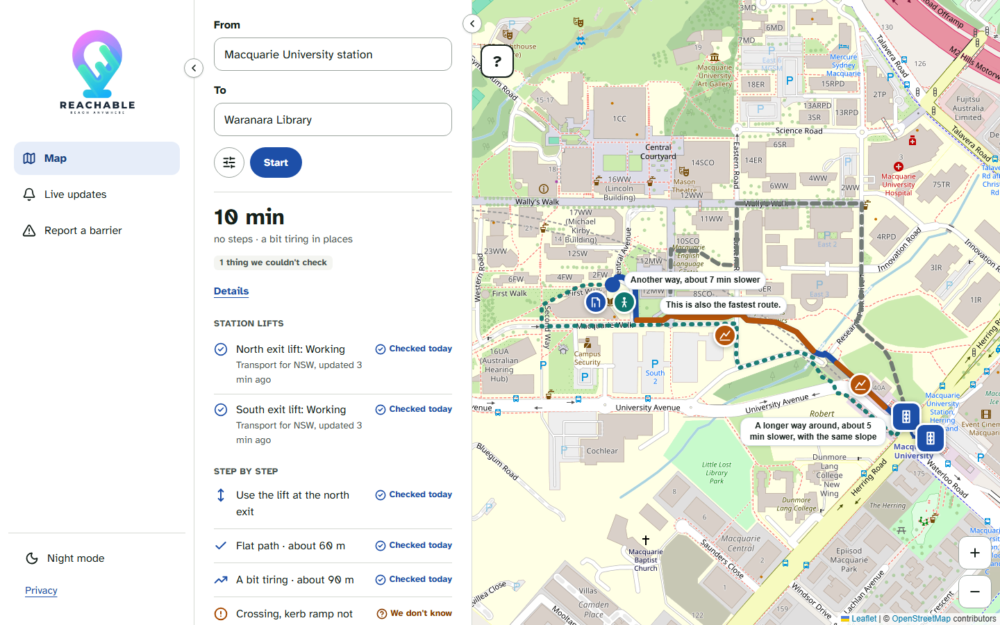
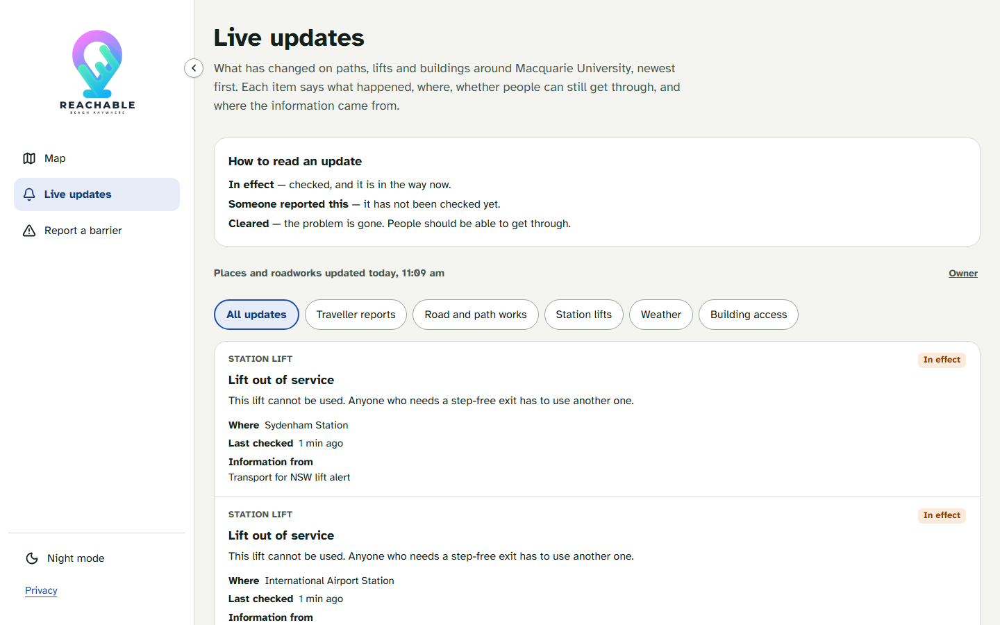

<div align="center">
  

  <h1>Reachable: from the stop to the door</h1>

  <p><i>An accessible door-to-door trip planner for Greater Sydney. Tap what you need, and it plans a step-free walk or roll, or public transport joined to step-free walks at both ends. It checks that the station lifts are working right now, says how hard each stretch is for <b>you</b>, and is honest about how sure it is.</i></p>

  <p>
    
    <a href="https://reachable-five.vercel.app"></a>
    
    
    
    
    
  </p>

  <p><b>Showcase:</b> <a href="https://reachable-five.vercel.app">https://reachable-five.vercel.app</a> (real trips recorded with the live app; run it live with the Quickstart below)</p>

  <p>Built for the Sym AI Open 2026 at Macquarie University.</p>
</div>

---

## Three things worth opening this repo for

1. **The part of the trip other apps skip.** Transport apps get you to the station; Reachable gets you from the station to the door. It routes step-free walks across Greater Sydney with a self-hosted Valhalla engine (and a measured campus map where slope limits are enforced), joins them to wheelchair-accessible Transport for NSW journeys, and matches live lift alerts to the exact station exit. If a lift is out, the route uses another exit and says why.

2. **Plain words, judged against you.** Nobody cares about "3% grade". Every slope is described against your own limit (Easy slope / A bit tiring / Hard, you may want help / Too steep for you), and every detail carries a trust label with its source and time (Checked today / Measured / Probably OK / Someone reported this / We don't know). Exact numbers sit behind "Details". The guidance voice never states an unconfirmed kerb ramp as fact.

3. **Open data kept current by agents.** A live updates agent reads Transport for NSW lift alerts and the weather every few minutes and pushes changes to open pages without a reload. A map agent, run by the owner, gathers about 5,500 accessible places across Sydney from OpenStreetMap and has **Claude** read every Live Traffic NSW roadwork and event to decide which ones affect people on foot or in a wheelchair, with one plain sentence each.

<p align="center">
  
  &nbsp;&nbsp;
  
</p>

---

## Architecture



The demo deployment: the web app is on Vercel; each judge's phone calls the API through a fixed CloudFront HTTPS address. Behind it, one AWS Fargate task runs the FastAPI service and Valhalla (with Greater Sydney built in) side by side, only while a demo is on: a script starts it, and an EventBridge schedule stops it after 9 hours. The API reads from a local copy of the Turso database and calls Transport for NSW, Claude, Photon and Open-Meteo for live data. An interactive version is in [`assets/diagrams/architecture.html`](assets/diagrams/architecture.html), generated with [Archify](https://github.com/tt-a1i/archify) from [`architecture.archify.json`](assets/diagrams/architecture.archify.json).

### Workflow



One trip, lane by lane. You tap your needs (how you get around, how steep you can go) and pick a place; search uses Photon, and falls back to Transport for NSW's place finder when Photon is down. The API plans the trip with Valhalla and the Trip Planner, checks the lifts on the way against live alerts (a lift out moves the route to another exit), and describes it for you. Press Start for step-by-step spoken guidance; live updates reroute an open trip without a reload. An interactive version is in [`assets/diagrams/workflow.html`](assets/diagrams/workflow.html), generated from [`workflow.archify.json`](assets/diagrams/workflow.archify.json).

### Request flow

```
Phone (web app, own X-Session key)
        |  HTTPS: /places, /route, /events (SSE)
        v
  CloudFront             fixed HTTPS address; /map/places cached 5 minutes
        v
  Session middleware     X-Session header or ?session=  ->  per-phone sandbox (demo)
        v
  Place search           Photon (cached 10 min)  ->  TfNSW stop_finder if Photon is down
        v
  Router                 campus graph (measured slopes, stairs, exits)
                         or Valhalla (Greater Sydney, estimated slopes)
        v
  Transit                TfNSW Trip Planner, wheelchair-accessible journeys,
                         joined to our own step-free walks at each end      (5 req/s limiter, 60 s cache)
        v
  Lifts + barriers       live lift alerts per station exit; reports; rain   (avoid, reroute, say why)
        v
  Steps                  kind, slope, measured  ->  "how hard for you" + trust label (web)
        v
  Live updates           Server-Sent Events: lift, barrier and rain changes reroute open trips
```

### How the pieces fit

**Two routers, one answer shape.** Campus trips use a prebuilt OpenStreetMap footpath graph (`api/data/graph.graphml`) with hand-measured slopes and station exits in `overrides.json`, so the slope limit is enforced. Everywhere else in Greater Sydney uses Valhalla's pedestrian costing with wheelchair settings; its elevation data is too coarse for a trustworthy limit at footpath scale, so those routes prefer flatter paths and say their slopes are estimated. Both return the same steps (`kind`, `slope`, `measured`), and the web app turns them into plain words. Source: `api/app/routing/`.

**Public transport, door to door.** For trips over 1 km the API asks the Transport for NSW Trip Planner for wheelchair-accessible journeys, keeps the rides and in-station paths it returns, and replaces the walks at each end with our own accessible routes. Up to three options, best first; a lift alert on your platform removes that option when another exists. Source: `api/app/transit/`.

**Live lifts.** Every 5 minutes the API reads current lift alerts. Macquarie University station exits are matched by the broken lift's OpenStreetMap id; other stations show on Live updates and on trips through them.

**The map agent.** Runs only when the owner asks (`POST /agents/map/run` with the admin key). It fetches accessible toilets, parking, step-free entrances and venues from Overpass, reads Live Traffic NSW roadworks and events, and sends them to Claude in batches of 25 to decide "blocks the path", "may affect" or car-only (dropped), with one sentence each. Everything is saved in one write. Without Claude it keeps the roadworks it has and adds none; it never guesses. Source: `api/app/mapdata/`.

**Turso with a local copy.** Reads come from an embedded replica (`turso-replica.db`) so they never wait on the network; writes go straight to Turso behind a single lock. The `libsql` driver holds Python's global lock during network calls, so searches write nothing, routes aren't logged, and the lift checker writes only when something changed. If Turso is unreachable at start-up the API runs read-only from the last copy.

**A sandbox per phone.** With `DEMO_SANDBOX=true` each phone's barrier reports and rain toggle live in memory under its own session key and are never saved, so 80 judges can test at once without changing each other's map. The event stream tags each event with its session.

**Load guards.** A 5-per-second limiter on Transport for NSW (the Bronze plan allows 5 a second and 60,000 a day), a 60-second trip cache that shares one call between identical concurrent requests, a 10-minute search cache, a 5-minute cache of the Sydney places list (in the app and at CloudFront), and gzip on everything except the event stream.

---

## Tech stack

| Layer | Choice |
|---|---|
| API | FastAPI, Uvicorn, SQLModel, sse-starlette, Pydantic Settings |
| Routing | Valhalla (self-hosted, Greater Sydney extract); campus graph with OSMnx and NetworkX |
| Public transport | Transport for NSW Open Data: Trip Planner, stop finder, lift alerts, Live Traffic hazards |
| Search | Photon (komoot) with Transport for NSW stop finder as fallback |
| Language model | Claude Sonnet 5.5 (`claude-sonnet-5-5`): roadwork triage, public transport explanations |
| Places | OpenStreetMap via Overpass; a saved snapshot of about 5,500 places ships with the repo |
| Weather | Open-Meteo |
| Storage | Turso (libsql) with an embedded replica; local SQLite for development |
| Web | Next.js 16, React 19, Tailwind CSS 4, shadcn/ui, react-leaflet 5, leaflet.markercluster |
| Hosting | Vercel (web); AWS Fargate, ECR, CloudFront, SSM Parameter Store, EventBridge Scheduler, CloudFormation (API + Valhalla) |
| Tests | pytest (312), Vitest (74), Playwright with axe accessibility checks (136); no real Turso, Transport for NSW, Overpass or Claude in tests |

---

## Quickstart

### Campus only, no Docker, no keys

Everything for the Macquarie University campus runs with just Python and Node.

**You need:** [Git](https://git-scm.com/), [Python 3.11+](https://www.python.org/downloads/) (tick "Add Python to PATH" on Windows), [Node.js 20+](https://nodejs.org/).

```bash
git clone https://github.com/NhatNguyen3001/Sym-AI-Hackathon-Reachable.git
cd Sym-AI-Hackathon-Reachable
```

**1. API** (first terminal)

```bash
cd api
python -m venv .venv
.venv/Scripts/python -m pip install -r requirements-dev.txt     # macOS / Linux: .venv/bin/python
cp .env.example .env                                            # Windows: copy .env.example .env
```

Open `api/.env` and set `ROUTER=campus` and `PHOTON_URL=` (empty) so everything stays on campus. Leave `TFNSW_API_KEY` and `TURSO_DATABASE_URL` empty: you get walk/roll routes only, a local SQLite database, and station lifts shown as "We haven't heard today" (there is no live lift data without the key).

```bash
.venv/Scripts/python -m uvicorn app.main:app --port 8000 --no-access-log
```

Check http://127.0.0.1:8000/health shows `{"ok":true,...}`. The web app calls `127.0.0.1`, not `localhost`: on Windows `localhost` tries IPv6 first and adds about 0.2 s to every request.

**2. Web** (second terminal)

```bash
cd web
npm install
cp .env.example .env.local      # Windows: copy .env.example .env.local
npm run dev
```

**3. Open** http://localhost:3000, or go straight to the demo trip: http://localhost:3000/route?from=mq-station&to=library

On first start the API loads the saved copy of about 5,500 Sydney places (`api/data/osm_places_snapshot.json`), so the map is full from the start. To start from fresh demo data, stop the API and delete `api/reachable.db`.

**Windows: "No such file or directory … Long Path" during `pip install`?** Clone somewhere short (for example `C:\dev\Sym-AI-Hackathon-Reachable`), delete `api\.venv` and install again, or turn on Windows long paths.

### Greater Sydney (Valhalla)

Requires Docker Desktop.

```bash
# 1. Download the Australia extract (~970 MB, once) and clip it to Greater Sydney (~85 MB)
api/.venv/Scripts/python api/scripts/build_sydney_extract.py

# 2. Build and serve the routing tiles (first start builds tiles + elevation, about 10 minutes)
docker compose up -d valhalla
curl localhost:8002/status        # ready when this returns JSON
```

Then set `ROUTER=valhalla` in `api/.env` and restart the API. If Valhalla is down, campus trips still work and other trips say "Route planning is unavailable".

### Public transport, live lifts and roadworks

1. Get a free key at [opendata.transport.nsw.gov.au](https://opendata.transport.nsw.gov.au) (an application with the Trip Planner APIs) and set `TFNSW_API_KEY` in `api/.env`.
2. For Claude-checked roadworks, set `ANTHROPIC_API_KEY` and `ADMIN_KEY` (a long random key of your own). On **Live updates**, open **Owner**, enter the key once (it stays in that browser, never in a URL) and press **Update map now**. A run takes about 5 minutes.
3. Optional: set `TURSO_DATABASE_URL` and `TURSO_AUTH_TOKEN` to use [Turso](https://turso.tech) instead of local SQLite. `/health` says which is in use.

### Deploy (Vercel + on-demand AWS)

From the repo folder in PowerShell, with the AWS CLI signed in (region `ap-southeast-2`) and Docker running. Full details in [`deploy/README.md`](deploy/README.md).

```powershell
powershell -File deploy\setup.ps1      # once: keys from api\.env into SSM (encrypted, never printed); creates the stack
powershell -File deploy\push.ps1       # after code changes: builds and uploads the API and Valhalla images
powershell -File deploy\start.ps1      # before a demo: starts the task, points CloudFront at it, auto-stop in 9 hours
powershell -File deploy\stop.ps1       # after a demo
powershell -File deploy\status.ps1     # running or not, health, when it stops itself
```

One Fargate task (2 vCPU, 4 GB) costs about US$0.12 an hour while running and nothing while stopped, apart from a few cents a month for the stored images. On Vercel, the `web` folder is the project; set `NEXT_PUBLIC_API_URL` to the CloudFront address before building (Next.js bakes it in), then run `setup.ps1 -VercelUrl https://<your-site>.vercel.app` so only your site may call the API.

### Configuration

API settings go in `api/.env` or the environment.

| Variable | Purpose | Default |
|---|---|---|
| `ROUTER` | `valhalla` for Greater Sydney, `campus` for the campus graph only (no Docker) | `valhalla` |
| `VALHALLA_URL` | Valhalla service | `http://localhost:8002` |
| `PHOTON_URL` | Address search; empty limits search to campus places | `https://photon.komoot.io` |
| `COVERAGE_BBOX` | Area served (west, south, east, north) | `149.97,-34.33,151.63,-32.99` |
| `MAX_LEG_KM` | Longest walk or roll | `10` |
| `TFNSW_API_KEY` | Public transport, lift alerts, roadworks, search fallback | Unset: walk/roll only |
| `TRANSIT_MIN_KM` | Shortest trip that also gets public transport options | `1` |
| `LIFT_POLL_SECONDS` | How often lift alerts are read; `0` turns polling off | `300` |
| `ANTHROPIC_API_KEY` | Claude for roadworks and trip explanations | Unset: templates, no new roadworks |
| `ADMIN_KEY` | Owner key for running the map agent | Unset: map agent off |
| `MAP_AGENT_PAUSED` | Freeze the map (for a demo) | `false` |
| `TURSO_DATABASE_URL`, `TURSO_AUTH_TOKEN` | Turso instead of local SQLite | Unset: `api/reachable.db` |
| `TURSO_SYNC_SECONDS` | How often the local copy syncs | `15` |
| `CORS_ORIGINS` | Web origins allowed to call the API (JSON list) | `["http://localhost:3000"]` |
| `DEMO_SANDBOX` | Each phone's reports and rain stay its own, never saved | `false` (`true` on AWS) |
| `PHOTO_UPLOADS` | Photo barrier reports | `false` |

---

## The app







**Map (`/`).** Accessible toilets, parking, step-free entrances and venues across Sydney, live lift outages and Claude-checked roadworks. Zoomed out, pins join into number bubbles that split as you zoom in; each kind can be turned on or off. Needs are set with filter chips: how you get around, "How steep can you go?" (Gentle only, Some hills, Most hills), what to avoid and what you need at the destination. A place pin opens a popup with **Go here**; only that button plans a route.

**Route (`/route`).** The trip next to the fastest one for comparison, public transport options with "Leave at" times, the station lifts on the way, and the destination check (entrance, steps inside, toilet). The summary reads like "10 min, no steps, a bit tiring in places"; exact distances and slopes are under **Details**.

**Guidance.** Press **Start** for directions that follow you, spoken aloud or muted, with a preview mode and "Plan again from here".

**Report a barrier (`/report`).** A blocked path, stairs, a broken ramp or a slippery path. A rule-based checker compares it with nearby reports and roadworks before it changes routes; one unbacked report shows as "Someone reported this". Photo reports are switched off for now.

**Live updates (`/live`).** Each lift, barrier and weather change explained in plain words, when the map was last updated, and the owner's **Update map now** button.

**Privacy (`/privacy`).** Trips are not stored. Needs, recent places and settings stay on the device; reports keep the type, place, note and time, not the reporter.

---

## API

In demo mode, requests carry an `X-Session` header (or `?session=` on the event stream, which cannot send headers) so each phone gets its own sandbox.

| Method and path | Description |
|---|---|
| `GET /places?q=` | Search places in the coverage area (campus places, Photon, or the TfNSW fallback). |
| `GET /places/{place_id}` | One place by id. |
| `POST /route` | Plan a trip for a set of needs: step-free walk or roll plus public transport options, with steps, lifts and warnings. |
| `GET /stations/{station_id}/lifts` | Lift status per station exit. |
| `GET /venue/{venue_id}/check` | Destination check: entrance, steps inside, toilet, with source and trust. |
| `GET /map/places?bbox=` | Accessible places and roadworks in a box (cached 5 minutes). |
| `GET /amenities` | Campus amenities. |
| `POST /reports` | Report a barrier; checked before it affects routes. |
| `GET /updates` | Recent live updates. |
| `GET /events` | Server-Sent Events: lift, barrier, rain and map changes. |
| `GET /weather` | Current rain at a point. |
| `GET /agents/status`, `GET /agents/map/status` | When the updates and map agents last ran. |
| `POST /agents/updates/run` | Read lift alerts now. |
| `POST /agents/map/run` | Run the map agent (owner key required). |
| `POST /demo/rain` | Toggle simulated rain (per phone in demo mode). |
| `GET /health` | Liveness and which database is in use. |

---

## Repo layout

```
.
├── api/
│   ├── app/
│   │   ├── main.py           # FastAPI app, session middleware, start-up (seed, replica, agents)
│   │   ├── config.py         # Settings from api/.env
│   │   ├── routers/          # route, places, map data, reports, venue, stations, events, agents, demo
│   │   ├── routing/          # campus graph router, Valhalla client, steps (kind, slope, measured)
│   │   ├── transit/          # Transport for NSW: trips, lifts, place finder, rate limiter
│   │   ├── places/           # resolver: campus places, Photon, TfNSW fallback
│   │   ├── mapdata/          # map agent: Overpass places, Live Traffic roadworks, Claude triage
│   │   ├── llm/              # Claude: public transport explanations
│   │   ├── sandbox.py        # per-phone demo sandbox
│   │   ├── checker.py        # rule-based barrier report checker
│   │   ├── db.py, replica.py # SQLite / Turso with an embedded replica
│   │   └── weather.py        # Open-Meteo rain
│   ├── data/                 # campus graph, overrides, elevation grid, places, OSM snapshot
│   ├── scripts/              # build the campus graph, the Sydney extract and the OSM snapshot
│   └── tests/                # pytest suite
├── web/
│   ├── app/                  # Next.js pages: map, route, report, live, privacy, about
│   ├── components/           # map, route timeline, trust badges, guidance panel, filter chips
│   ├── lib/                  # API client, plain wording, guidance, session, storage
│   └── tests/                # Vitest unit tests and Playwright e2e (with a mock Transport for NSW)
├── deploy/                   # CloudFormation stack, PowerShell start/stop scripts, load test, Valhalla image
├── assets/                   # Diagrams (PNG + interactive Archify HTML and source), screenshots
├── valhalla/                 # local Valhalla extract and tiles (built locally, not committed)
├── docker-compose.yml        # local Valhalla
└── README.md
```

---

## Data

| Source | Records | Notes |
|---|---|---|
| `api/data/graph.graphml` | Macquarie University campus | OpenStreetMap footpaths with stairs, slopes and station exits; prebuilt by `scripts/build_graph.py` |
| `api/data/overrides.json` | Campus | Hand-measured slopes and station exit details |
| `api/data/osm_places_snapshot.json` | About 5,500 | Accessible places across Greater Sydney from OpenStreetMap (© OpenStreetMap contributors, ODbL); refreshed by `scripts/build_osm_snapshot.py` |
| Transport for NSW (live) | | Trips, lift alerts, stop finder and Live Traffic hazards, read with your own key |
| Valhalla tiles (built locally) | Greater Sydney | Clipped from the Geofabrik Australia extract by `scripts/build_sydney_extract.py` |

---

## Measured behaviour

**Load test against the deployed backend** (`deploy/loadtest.py`): 80 simulated judges for 3 minutes, each searching, planning routes, loading the map and holding the event stream open.

| Measure | Result |
|---|---|
| Requests | 4,360 |
| Errors | 0 |
| Route, median | 125 ms |
| Search, median | 1.4 s |
| Sydney places list, median (local, before and after caching) | 6.1 s → 0.32 s |

**What it costs.** The backend is one Fargate task at about US$0.12 an hour, only while a demo is on; an auto-stop after 9 hours caps a forgotten session at about US$1.10. Vercel's free tier serves the web app. Claude is called only when the owner runs the map agent (batches of 25 roadworks) and for public transport explanations.

Two design decisions came from measurement. The default SQLAlchemy connection pool's overflow churn made the `libsql` driver crash under concurrent reads, so reads use a fixed pool of 20. And every Turso round trip pauses the whole API (a write about 0.6 s, a sync 0.1 to 0.3 s), which is why reads come from the local copy and the hot paths write nothing.

---

## Limitations

- **Slopes outside campus are estimates.** Valhalla's elevation data is too coarse for a trustworthy limit at footpath scale; routes say so. NSW LiDAR would fix this.
- **Kerb ramps are mostly unknown.** OpenStreetMap rarely tags them; the app says "We don't know" rather than guessing.
- **Destination details are community data.** OpenStreetMap accessibility tags show as "Probably OK", not verified.
- **The map agent runs by hand.** There is no schedule; the owner presses **Update map now**.
- **Photo reports are switched off.** The upload and Claude labelling code remains behind `PHOTO_UPLOADS`; photos would need object storage before a real launch.
- **One API instance.** Search results and live updates are held in that server's memory, so a second instance behind a load balancer would not share them.
- **The demo sandbox forgets.** In demo mode, reports and rain live in memory per phone and vanish when the task stops.
- **The public site is a recorded showcase.** https://reachable-five.vercel.app plays back five trips recorded with the live app (built with `NEXT_PUBLIC_SHOWCASE=1`, no backend). The live app runs locally (Quickstart) or on the on-demand AWS backend (`deploy/`).

---

## Acknowledgements

- [Anthropic Claude](https://www.anthropic.com/) for roadwork triage and public transport explanations
- [Transport for NSW Open Data](https://opendata.transport.nsw.gov.au) for trips, lift alerts, the stop finder and Live Traffic NSW
- [OpenStreetMap](https://www.openstreetmap.org/copyright) contributors, [Overpass API](https://overpass-api.de/) and [Geofabrik](https://www.geofabrik.de/) for footpaths and places
- [Valhalla](https://github.com/valhalla/valhalla) for routing, [Photon](https://photon.komoot.io) for search, [Open-Meteo](https://open-meteo.com/) for weather
- [Turso](https://turso.tech) for the database
- [FastAPI](https://fastapi.tiangolo.com/), [SQLModel](https://sqlmodel.tiangolo.com/), [OSMnx](https://github.com/gboeing/osmnx), [Next.js](https://nextjs.org/), [Leaflet](https://leafletjs.com/), [react-leaflet](https://react-leaflet.js.org/), [Tailwind CSS](https://tailwindcss.com/) and [shadcn/ui](https://ui.shadcn.com/)
- [Archify](https://github.com/tt-a1i/archify) for the architecture and workflow diagrams
- AI coding assistants (Claude Code) were used under team review
